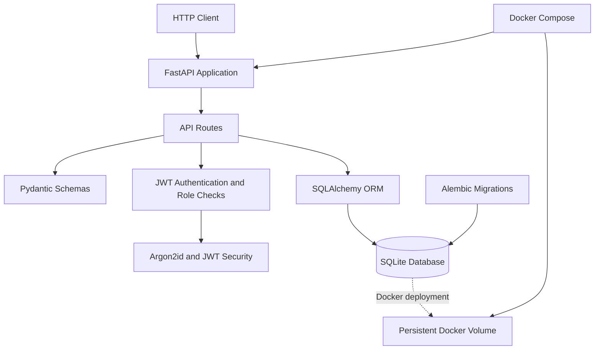

# Valorium Orders API

[](https://github.com/Guilherme-Langkammer/valorium-orders-api/actions/workflows/tests.yml)
[](https://github.com/Guilherme-Langkammer/valorium-orders-api/actions/workflows/docker.yml)

A RESTful order management API built with Python, FastAPI, SQLAlchemy, and Alembic.

This is an independent, public backend engineering portfolio project demonstrating API design, relational data modeling, request validation, database migrations, business rules, and automated testing.

## Features

- Create orders containing one or more items
- Automatically calculate order totals using integer cents
- List orders and retrieve individual orders
- Manage order status transitions with administrator authorization
- Validate requests using Pydantic
- Persist orders and items using SQLAlchemy
- Manage database schema changes with Alembic
- Run automated tests with pytest
- Register and authenticate users with JWT bearer tokens
- Hash passwords with Argon2id
- Enforce role-based permissions for order status updates
- Explore the API using interactive OpenAPI documentation

## Tech Stack

- Python
- FastAPI
- Pydantic
- SQLAlchemy
- Alembic
- SQLite
- pytest
- Uvicorn
- PyJWT
- argon2-cffi
- Docker and GitHub Actions

## Project Structure

```text
valorium-orders-api/
|-- alembic/
|   |-- versions/
|   `-- env.py
|-- app/
|   |-- api/
|   |   `-- v1/
|   |       |-- auth.py
|   |       |-- health.py
|   |       `-- orders.py
|   |-- core/
|   |   `-- security.py
|   |-- db/
|   |   `-- database.py
|   |-- models/
|   |   |-- order.py
|   |   `-- user.py
|   |-- schemas/
|   |   |-- auth.py
|   |   `-- order.py
|   |-- services/
|   `-- main.py
|-- tests/
|   |-- test_auth.py
|   |-- test_health.py
|   |-- test_orders.py
|   `-- test_security.py
|-- alembic.ini
|-- main.py
|-- pytest.ini
`-- requirements.txt
```

The `services` directory is reserved for future extensions. The `core` directory contains JWT and password security helpers.

## API Endpoints

| Method | Endpoint | Access | Description |
| --- | --- | --- | --- |
| GET | `/health` | Public | Check API health |
| POST | `/api/v1/auth/register` | Public | Register a standard user |
| POST | `/api/v1/auth/login` | Public | Obtain a JWT access token |
| GET | `/api/v1/auth/me` | Authenticated | Retrieve the current user |
| POST | `/api/v1/orders` | Authenticated | Create an order |
| GET | `/api/v1/orders` | Authenticated | List orders |
| GET | `/api/v1/orders/{order_id}` | Authenticated | Retrieve an order |
| PATCH | `/api/v1/orders/{order_id}/status` | Admin only | Update order status |

Interactive documentation is available at `/docs`.

## Authentication and Authorization

The API uses Argon2id password hashes and HS256 JWT bearer tokens.
Access tokens expire after 30 minutes. The signing key is supplied
through `JWT_SECRET_KEY` and must contain at least 32 UTF-8 bytes.

Public registration always assigns the `user` role. The registration
endpoint does not accept administrator privileges. There is no public
administrator provisioning endpoint.

### Register

```http
POST /api/v1/auth/register
Content-Type: application/json
```

```json
{
  "email": "developer@example.com",
  "password": "ExamplePassword123!"
}
```

Registration returns HTTP `201`. Passwords must contain 12 to 128
characters. Duplicate emails return HTTP `409`. Email addresses are
normalized to lowercase.

### Login

```http
POST /api/v1/auth/login
Content-Type: application/json
```

```json
{
  "email": "developer@example.com",
  "password": "ExamplePassword123!"
}
```

A successful login returns an `access_token` and `token_type: bearer`.
Send the token with protected requests:

```http
Authorization: Bearer <access_token>
```

`GET /api/v1/auth/me` returns the authenticated user's public profile,
including their role and active status, but not their password hash.

### Permissions

- `GET /health`, registration, and login are public.
- All order endpoints require a valid token belonging to an active user.
- Authenticated `user` and `admin` accounts can create and read orders.
- Only `admin` accounts can change order status.
- Missing or invalid credentials return HTTP `401`.
- Insufficient permissions return HTTP `403`.

**Current security boundary:** orders are not associated with a user
or tenant. Any authenticated user can currently read all orders.
This demonstration is not suitable for multi-tenant production use
without ownership or tenant isolation, additional security controls,
and deployment hardening.

## Order Creation Example

Request:

```http
POST /api/v1/orders
Authorization: Bearer <access_token>
Content-Type: application/json
```

```json
{
  "customer_name": "Demo Customer",
  "items": [
    {
      "product_name": "Coffee",
      "quantity": 2,
      "unit_price_cents": 1250
    }
  ]
}
```

The API creates an order with:

- Initial status: `pending`
- Calculated total: `2500` cents
- One associated order item

A successful creation returns HTTP `201`.

Monetary values use integer cents to avoid floating-point rounding issues.

## Order Status Rules

Supported statuses:

- `pending`
- `confirmed`
- `cancelled`

Allowed transitions:

```text
pending
  |-- confirmed
  `-- cancelled
```

Orders in `confirmed` or `cancelled` status cannot transition to another status in the current implementation.

Invalid status transitions return HTTP `409 Conflict`.

Example:

```http
PATCH /api/v1/orders/1/status
Authorization: Bearer <admin_access_token>
Content-Type: application/json
```

```json
{
  "status": "confirmed"
}
```

## Validation and Error Handling

The API uses Pydantic to enforce input constraints.

Examples:

- Customer names must contain at least one character
- Orders must contain at least one item
- Product names must contain at least one character
- Item quantities must be greater than zero
- Unit prices cannot be negative

Invalid request data returns HTTP `422`.

Requests for nonexistent orders return HTTP `404`.

## Getting Started

### 1. Clone the repository

```bash
git clone https://github.com/Guilherme-Langkammer/valorium-orders-api.git
cd valorium-orders-api
```

This repository is publicly available on GitHub.

### 2. Create a virtual environment

```bash
python -m venv .venv
```

Activate it on Windows PowerShell:

```powershell
.\.venv\Scripts\Activate.ps1
```

On Linux or macOS:

```bash
source .venv/bin/activate
```

### 3. Install dependencies

```bash
python -m pip install -r requirements.txt
```

### 4. Configure the JWT signing key

Set a strong secret in your terminal before starting the API.
Do not commit the secret to Git.

Windows PowerShell:

```powershell
$env:JWT_SECRET_KEY = & python -c "import secrets; print(secrets.token_hex(32))"
```

Linux or macOS:

```bash
export JWT_SECRET_KEY="$(python -c 'import secrets; print(secrets.token_hex(32))')"
```

The generated value is intended for local development. Keep the same
secret for as long as existing tokens must remain valid.

### 5. Apply database migrations

```bash
python -m alembic upgrade head
```

The default configuration uses a local SQLite database named `orders.db`.

You can override the database connection through the `DATABASE_URL` environment variable.

### 6. Start the API

```bash
python -m uvicorn main:app --reload --host 127.0.0.1 --port 8000
```

Open:

- API documentation: http://127.0.0.1:8000/docs
- Health check: http://127.0.0.1:8000/health
- OpenAPI schema: http://127.0.0.1:8000/openapi.json

## Database Migrations

Database schema changes are managed through Alembic.

Apply migrations:

```bash
python -m alembic upgrade head
```

Show the current revision:

```bash
python -m alembic current
```

The application does not automatically create database tables at startup. Run the migrations before using the order endpoints.

## Automated Tests

Run the test suite:

```bash
python -m pytest -q
```

The current test suite covers:

- Health endpoint
- OpenAPI schema availability
- Order creation and total calculation
- Order listing and retrieval
- Empty item list validation
- Negative price validation
- Valid and invalid status transitions
- Missing order handling
- User registration and duplicate email rejection
- Public registration privilege escalation prevention
- Login, token validation, and authenticated profile retrieval
- Inactive user rejection
- Argon2id hashing and JWT expiration checks
- Protected order routes and administrator-only status updates

Order and authentication tests use isolated in-memory SQLite databases. The test suite currently contains 29 passing tests.

## Architecture Overview



The API separates HTTP routing, data validation, ORM models, and database configuration. Docker Compose runs database migrations before starting the application and stores SQLite data in a named volume.

## Architecture Notes

The project separates:

- HTTP routes in `app/api`
- Request and response contracts in `app/schemas`
- ORM entities in `app/models`
- Database configuration in `app/db`
- Authentication and password security in `app/core/security.py`
- Application initialization in `app/main.py`
- Automated tests in `tests`

This structure supports future improvements without coupling HTTP handling directly to database configuration.

## Project Status

This is a portfolio project under active development.

Current functionality includes order management, database migrations, JWT authentication, basic role-based authorization, Docker packaging, and automated testing.

Production deployment and tenant-level order isolation are not implemented. Administrator accounts cannot be created through public registration.

Docker and Docker Compose are validated automatically on GitHub-hosted Ubuntu runners through the Docker CI workflow.

GitHub Actions CI is implemented and has successfully completed its initial run.


## Docker

The project includes a Dockerfile and Docker Compose configuration.

The container runs the API as a non-root user. Docker Compose applies Alembic migrations before starting Uvicorn and uses a named volume to persist the SQLite database.

Before starting Docker Compose, set `JWT_SECRET_KEY` in the shell running Docker Compose. The variable is mandatory; do not store a real secret in the repository.

For example, on Linux or macOS:

```bash
export JWT_SECRET_KEY="$(python -c 'import secrets; print(secrets.token_hex(32))')"
docker compose up --build -d
```

Open the API documentation at http://127.0.0.1:8000/docs.

Stop the containers:

```bash
docker compose down
```

The named database volume is retained by default. Avoid using `docker compose down -v` if you want to preserve the database.

**Validation:** Docker CI builds the image, starts the API, checks health and migrations, tests JWT authentication over HTTP, and verifies SQLite persistence after a container restart. The updated workflow must pass on GitHub Actions before it is considered verified.

## Continuous Integration

GitHub Actions runs two independent workflows on pushes and pull requests targeting `main`.

### Backend CI

- Sets up Python 3.14 on Ubuntu
- Installs project dependencies
- Validates Python syntax
- Applies Alembic migrations
- Runs automated pytest tests

### Docker CI

- Builds the application Docker image
- Starts the API through Docker Compose
- Checks the `/health` endpoint
- Generates a temporary JWT signing secret for each CI run
- Exercises JWT authentication over HTTP
- Verifies the Alembic migration in SQLite
- Writes a persistence marker to the database
- Restarts the API container
- Confirms that the marker survives the restart
- Collects logs on failure and cleans up test resources

Earlier versions of both workflows passed on GitHub Actions. The updated JWT-enabled Docker workflow is pending a new CI run.

These checks run on GitHub-hosted Ubuntu runners; Docker does not need to be installed on the developer's Windows machine.

## Author

Guilherme Langkammer

GitHub: https://github.com/Guilherme-Langkammer

## Disclaimer

This repository is an independent demonstration project. It does not contain proprietary customer systems, production credentials, or commercial application source code.